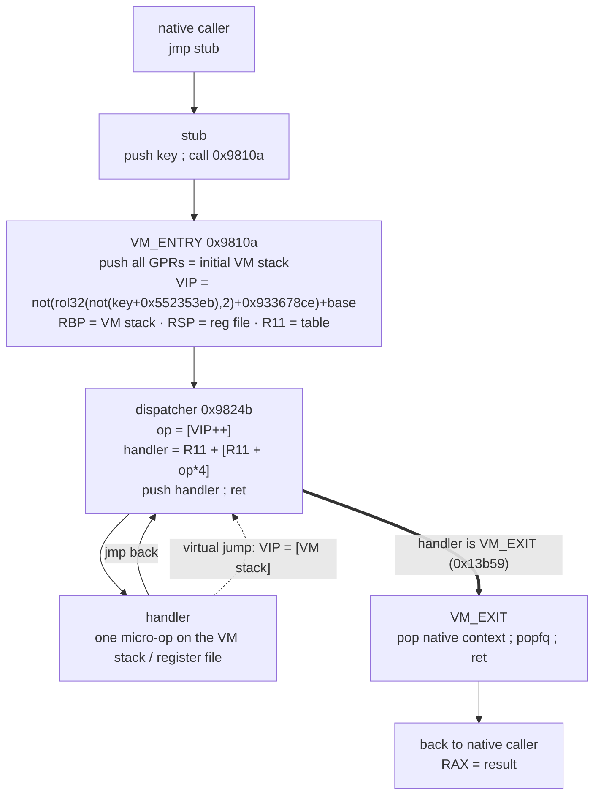
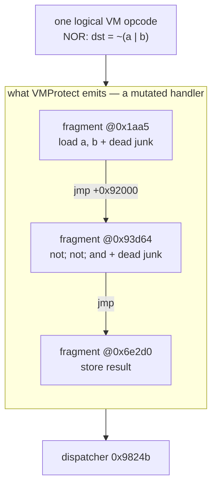
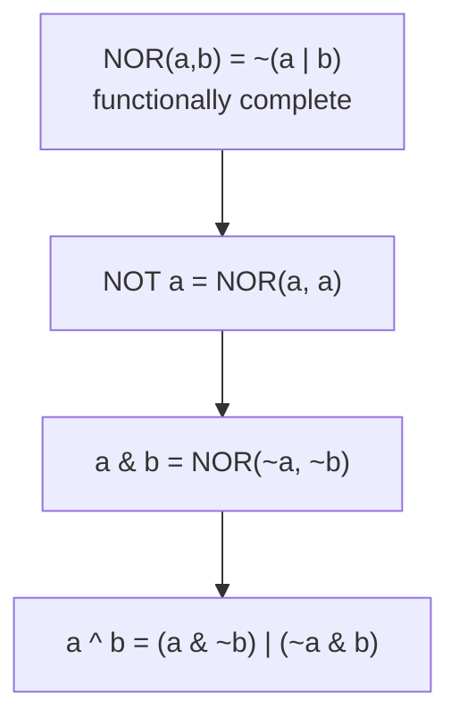
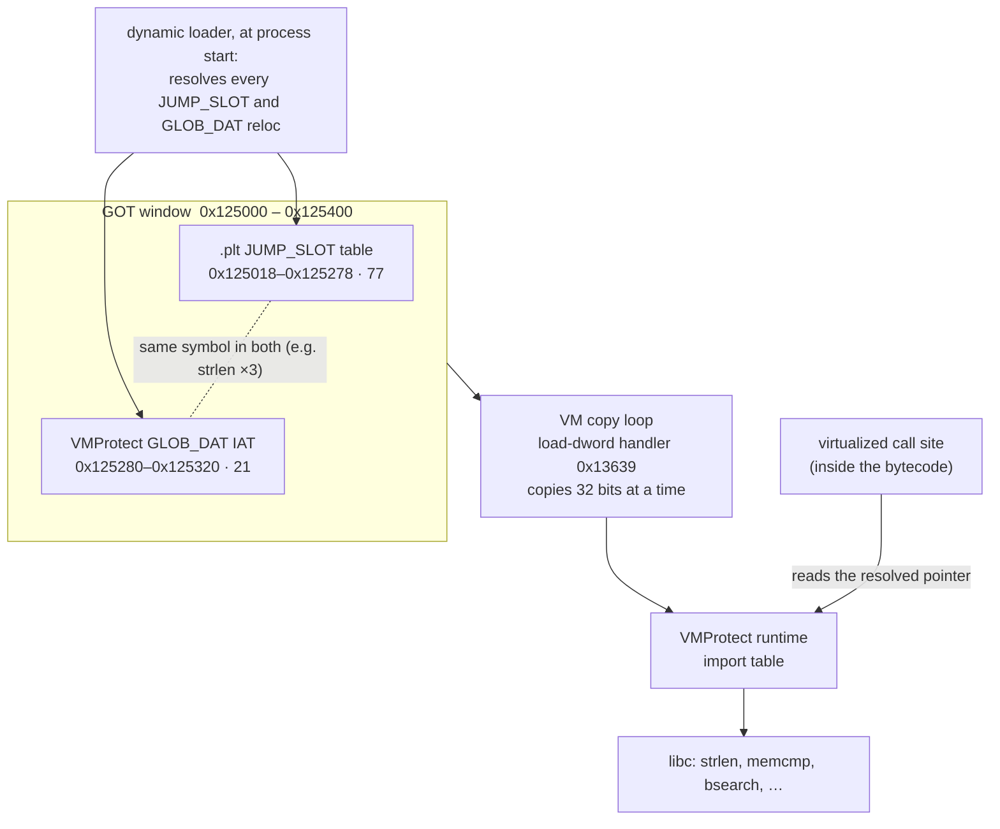
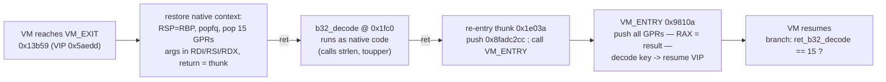
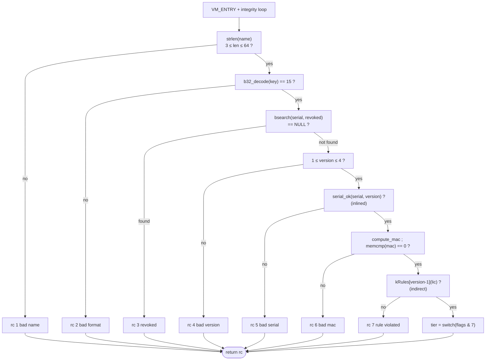

## Again A Short Story Before Starting

We have already done an analysis of VMProtect using Dragon-tales and Claude AI. Although Claude using the symbolic execution capabilities from Dragon-tales, as well as the simplification capabilities from Z3 and the optimizations from LLVM was able to remove the virtual machine from the code, VMProtect presented as a very strong protection. 

This research was encouraged by a talk by [@mr_phrazer](https://x.com/mr_phrazer) and [@nicolodev](https://x.com/nicolodev) called ["Deobfuscation in the Age of Agentic Reverse Engineering"](https://www.youtube.com/watch?v=3-gJ6EUFoKM).

This time the idea is complicating the binary, and using a stronger protection from VMProtect. But for now, let's move to the post!

## Why a second case

The [first post]() took one VMProtect-virtualized
function — `check_serial`, a leaf with no calls, every protection but
virtualization turned off — from the VM entry stub all the way to a recompiled
native executable indistinguishable from the original. That was the clean
laboratory case: one function, one protection, a Windows PE, and a VM whose 256
handler slots were polymorphic *copies* of about twenty-five opcode classes.

This post is the messy one, and it is messy on purpose. The target, **License-Check**,
was built to break every assumption the first case was allowed to make:

- It is a **Linux ELF**, a PIE loaded at base 0, with its section headers
  stripped. dragon-tales had to learn to load it at all.
- One of the two protected functions is **Ultra = virtualization + mutation**.
  Mutation scatters each handler across the image and rewrites it, so the 256
  handler slots are no longer copies of a few classes — they are **256 distinct
  shapes**, and the function carries a huge input-independent loop whose only
  job is to make a trace explode.
- The other function **leaves the VM constantly**: it calls libc imports
  (`strlen`, `memcmp`, `bsearch`, …), it calls a *second* virtualized function,
  and it dispatches through a **function-pointer table** (`kRules[version-1]`).
  None of those paths existed in the first case.
- There is **CPUID anti-tamper** that poisons the virtual instruction pointer if
  you are not careful, and an **anti-breakpoint check** that reads the first
  bytes of a call target before jumping to it.

Everything below is driven with **dragon-tales** — its symbolic executor, the
IGNIL lifter, and the custom z3→LLVM lowering — plus **Unicorn** (fast concrete
x86), **Capstone**, **Z3**, and, for one experiment, **CoBRA**. Unlike the first
post, the whole pipeline runs on **Linux**, and because the target is an ELF we
can actually run it, which gives us something the PE case never had: a live
oracle.

**Companion repo.** Every binary, script and generated file referenced here
lives in the **[`License-Check/`](https://github.com/Fare9/Dragons-vs-VMs/tree/main/License-Check)**
case directory of the VMProtect analysis archive. Paths like
`scripts/vmp_devirt.py` are relative to it.

### The target

`source/license_check.c` validates a *name* plus a *license key*. The key is 24
Crockford base32 symbols (dashes optional, case-insensitive) that decode to 15
bytes:

| bytes  | field                         |
|--------|-------------------------------|
| 0      | version (1..4)                |
| 1      | flags                         |
| 2..3   | expiry (LE16)                 |
| 4..5   | seats (LE16)                  |
| 6..9   | serial (LE32)                 |
| 10..14 | mac                           |

Two functions are protected, and they are deliberately the two ends of the
difficulty spectrum:

- **`serial_ok(serial, version)` — Ultra.** A leaf: no imports, no calls. The
  *easy-hard* one. The logic is four lines of arithmetic, but mutation scatters
  it and buries it under an integrity loop, so the hard part is getting *through*
  the protection, not understanding the result.
- **`validate_license(name, key, out)` — Virtualization.** The *hard* one. The
  logic is a return-code ladder — bad name, bad format, revoked, bad version,
  bad serial, bad mac, rule violated, ok — and every rung of that ladder is a
  call out of the VM. The hard part here is not the protection, it is the
  constant traffic across the VM boundary.

Three oracles keep everything honest:

1. `scripts/lc_model.py`, an independent Python reimplementation: `keygen`,
   `check(name, key) -> rc` (0–7), and the primitives (`b32_decode`,
   `serial_ok`, `compute_mac`, `rule`).
2. the **unprotected** build `build/license_check`, diffed against the model on
   653 inputs.
3. the **protected** ELF run live under WSL (see the next section), which tells
   us the protection itself is faithful.


## The shared virtual machine

Both functions are entered through the same VM. A per-function stub pushes a key
and calls the shared entry:

```asm
; serial_ok
0x1aa0:  jmp 0xb17c1  ->  push 0x4faa8408 ; call 0x9810a   ; VM_ENTRY
; validate_license
0x20b0:  jmp 0xbfb7e  ->  push 0x4facabfb ; call 0x9810a   ; VM_ENTRY
```

The key is the only per-function input to the VM. `VM_ENTRY` at `0x9810a` saves
the native context — it `push`es every GPR, and that saved block *is* the
initial VM stack — and decodes the key into the virtual instruction pointer with
a small reversible mixer. The decode is six real instructions, interleaved with
dead junk (`bt`, `btc`, `ror r10d`, `neg dh`, … — none of it reaches `esi`):

```asm
0x981a4: mov  esi, [rsp+0x80]      ; esi = the key the stub pushed
0x981b1: add  esi, 0x552353eb
0x981c4: not  esi
0x981c6: rol  esi, 2
0x981c9: add  esi, 0x933678ce
0x981dc: not  esi
0x981eb: lea  rsi, [rsi + rax]     ; + image base  ->  RSI = VIP
```

That is `VIP = not(rol32(not(key + 0x552353eb), 2) + 0x933678ce) + base`, which
gives `0xe700` for `serial_ok` and `0x986cc` for `validate_license`. That
`rol esi, 2` is the first thing that mattered: without a correct rotate lifter
the VIP went symbolic at the very first step (see
[dragon-tales work](#part-6--dragon-tales-work)).

The register roles, confirmed from concrete memory effects rather than from
naming:

| native | role |
|---|---|
| `RSI` | virtual instruction pointer (VIP) into the bytecode |
| `RBP` | VM stack pointer |
| `RSP` | virtual register file base (`RBP - 0x200`, 16-aligned) |
| `R11` | handler-table base, `0x5b994`, 256 entries |

The dispatcher at `0x9824b` is the classic fetch/decode/`push`/`ret`:

```asm
0x9824b: movzx eax, byte [rsi]         ; opcode = *VIP
         add   rsi, 1                  ; VIP++
         movsxd rdx, dword [r11+rax*4] ; rel32 handler-table entry
         add   rdx, r11                ; absolute handler
         push  rdx ; ret               ; dispatch
```

Opcodes are not encrypted. The two data-dependent control-flow points — the VM's
indirect jumps — are the two handlers that load the VIP from VM-stack data:
`0x8954d` (`mov rsi, [rbp]`) and `0x13b59` (`pop rsi`). Everything between two
indirect jumps is one straight-line block. This is the same `(pc, VIP)` machine
model the first post used; what changes is everything *around* it.

The exit mirrors the entry. The VM_EXIT handler (`0x13b59`) restores `RSP`, the
flags and every saved GPR off the VM stack and `ret`s into the caller with the
result in `RAX`:

```asm
0x13b59: mov  rsp, rbp
0x13b5c: popfq                     ; restore the saved RFLAGS
0xceb06: pop  rsi                  ; -.
0xceb0e: pop  r9                   ;  | pop the saved native context -
0xc8768: pop  rbp ; pop rdx        ;  | the same registers VM_ENTRY pushed
0xc876e: pop  r15 ; pop r13 ; pop rax
         ...                       ; -'
0xad62e: ret                       ; -> back to the caller, RAX = return value
```

Put together, a virtualized call lives this life — native code jumps to the
stub, the stub calls `VM_ENTRY`, the key is decoded into the VIP, and the
dispatcher and handlers trade control through `push`/`ret` until a handler turns
out to be the exit:




## Ground truth: running an ELF that fights back

In the PE case we could never run the protected binary — the VMProtect demo
pops a message box on Windows. Here the target is an ELF, so it runs under
**WSL2**, and that gives us a live oracle. The catch is that the demo build
*self-destructs* under any instrumentation, in layers.

Two `LD_PRELOAD` stubs defeat the layers:

1. it calls libc `kill()` to `SIGKILL` itself → stub `kill` (and `ptrace`) to
   return 0;
2. it then triggers a glibc *"free(): double free detected in tcache"* abort
   (a demo anti-tamper) → override `free` to ignore a pointer it has already
   freed.

```c
typedef unsigned long u64; static u64 freed[65536], n = 0;
extern void __libc_free(void *);
int  kill(int p, int s) { return 0; }
long ptrace(int r, int p, void *a, void *d) { return 0; }
void free(void *ptr) {
    if (!ptr) return;
    for (u64 i = 0; i < n; i++) if (freed[i] == (u64)ptr) return;
    if (n < 65536) freed[n++] = (u64)ptr;
    __libc_free(ptr);
}
```

With `LD_PRELOAD=shim.so ./license_check_vmp <name> <key>` the binary runs
correctly and matches `lc_model` on grant, denial and every failure code. That
single fact reframes the entire effort: whenever a trace later diverges, we know
the function is faithful and the divergence is *ours* — a harness problem, not a
protection we failed to understand. (The ELF is untrusted; it stays inside WSL
and its output is never piped anywhere.)


## Part 1 — `serial_ok`: a clean win against mutation

`serial_ok` is four lines of C:

```c
uint64_t x = (uint64_t)serial * 0x9E3779B97F4A7C15ull;
x ^= x >> 29;
return ((x % (1000003u + version)) % 7u) == 3u;
```

Getting from the Ultra-protected bytecode back to that took three ideas that the
first, unmutated case never needed.

### 1.1 The keystone: concretizing CPUID at the source

The VM runs a `cpuid` as anti-tamper. dragon-tales correctly models `cpuid`/`rdtsc`
as **opaque** operations that return an uninterpreted symbol — that is the right
thing to do for pure symbolic reasoning, since two `cpuid`s with the same leaf
are provably equal. But in a trace that symbol flows into the dispatch key and
makes the **VIP symbolic**, which strands the whole exploration on the solver.

Here is the `cpuid` as it actually sits in the VM. The handler reads the leaf and
subleaf off the VM stack, runs the instruction, and pushes the four result
registers back — and mutation has scattered the four pushes across the image,
chained by `jmp`s, so a plain disassembler sees four unrelated fragments:

```asm
0x74e60: mov   eax, [rbp]          ; leaf    <- top of the VM stack
0x74e67: mov   ecx, [rbp+4]        ; subleaf
0x74e74: cpuid
0x74e76: sub   rbp, 8
0x74e7d: mov   [rbp+0xc], eax      ; push EAX
0x74e80: jmp   0x14a65             ; (mutation: the four pushes live far apart)
0x14a65: mov   [rbp+8], ebx        ; push EBX
         jmp   0xd5c5c
0xd5c5c: mov   [rbp+4], ecx        ; push ECX
         jmp   0xce125
0xce125: mov   [rbp], edx          ; push EDX
         ...                       ; -> stack guard -> dispatcher at 0x9824b
```

Follow that `EAX` from the `cpuid` down to the dispatcher, and the poison is
plain:

1. dragon cannot execute `cpuid`, so it models it as **opaque**: the four results
   come back as fresh symbols, e.g. `cpuid.1.eax`.
2. The handler pushes them onto the VM stack (above). A few handlers later the VM
   pops one and folds it — NOR-spelled — into the value it is building for the
   next VIP.
3. Now `RSI` (the VIP) is a symbol. The dispatcher runs `movzx eax,[rsi]` →
   `movsxd rdx,[r11+rax*4]` → `push rdx; ret`, so the handler-table index, and
   then the `ret` target, are symbolic too.
4. The explorer forks at the symbolic VIP and asks the solver for its values; the
   answer is an unbounded set, so it either abandons or forks into wrong VIPs. The
   explore wanders and the retained-state set grows without bound — the first run
   this way ate all 96 GB and froze the machine.

`rdtsc` is the opposite case: VMProtect sprinkles it into the shared `VM_ENTRY`
prologue, but its result is dead — nothing in the dispatch reads it back:

```asm
0x98161: rdtsc
0x98163: movzx ax, r10b            ; the low word of EAX is overwritten at once
0x98169: pushfq                    ; (VM_ENTRY's RFLAGS capture, a few insns later)
```

So `cpuid` must be concretized and `rdtsc` can be left symbolic — concretizing
`rdtsc` in this shared prologue block actually broke the dispatch setup, so we
leave it alone.

**The fix, before and after.** The first attempt was a Python workaround: after
each dispatch, `assume(read_register(r) == fake)` for every register still
carrying the `cpuid` symbol, then re-sweep VM memory. That made the value
*determined* but never *literal* — the z3 term still had the `cpuid` symbol
inside it, grew a little every time step 2 folded it again, and after a few
thousand dispatches each step took ~2 s. The real fix moved into dragon-tales, so
the symbol is **never created in the first place**:

```cpp
SymbolicExecutor::setConcreteOpaque(kind, selector, results);  // e.g. CPUID, leaf 1
```

Now `opaqueValue()` returns a literal bitvector for a registered `(kind, leaf)`.
`vmp_devirt.py` registers a plain desktop Intel identity (no hypervisor bit,
leaves 0 and 1), so step 1 above hands back a *number*, the VIP in step 3 stays
concrete, and the dispatcher resolves with no solver call at all. This one change
([dragon-tales #24](#part-6--dragon-tales-work)) unblocked everything else.
`rdtsc` stays symbolic: its result is dead, and concretizing it in the shared
prologue clobbered the dispatch setup.

### 1.2 Mutation: 256 handlers, 256 shapes

Lifting every handler slot in isolation and classifying it by its recovered
effect gives the opcode table. In the first (unmutated) case the 256 slots
collapsed into about 25 classes with many polymorphic copies each. Here, with
mutation on, **every one of the 256 slots is a distinct shape** — that is the
mutation signature. You cannot recover a handler by finding its twin, because it
has none.

**What mutation does to one handler.** Take slot `0xa0`, the VM's NOR gate. Its
real work is six instructions: read two VM-stack slots, `not` both, `and` them,
push the result. Mutation (a) pads it with dead instructions — writes to
registers that are overwritten before use, flag-only ops — and (b) splits it
into fragments scattered across the image, chained by `jmp`. Here it is as it
sits in the binary, junk marked:

```asm
0x1aa5: mov   rdi, [rbp]        ; a = top of VM stack
0x1aaa: mov   r9w, 0x19aa       ; -.
0x1aaf: bsr   r9, rbx           ;  | junk: r9 is overwritten two lines down
0x1ab3: or    r9w, r9w          ; -'
0x1ab7: mov   r9, [rbp+8]       ; b = second slot
        jmp   0x93d64           ; (fragment 2 lives 0x92000 bytes away)
0x93d64: not  rdi               ; ~a
0x93d67: test bp, sp            ; -. junk: flags only
0x93d6a: clc                    ; -'
0x93d6b: not  r9                ; ~b
0x93d6e: and  rdi, r9           ; ~a & ~b   ==  ~(a | b)
0x93d71: mov  r9b, 0x33         ; -. junk: r9 dead, pushfq/pop below is a no-op pair
0x93d74: movsxd r9, eax         ;  |
        ... pushfq ; pop r9 ...  ; -'
        jmp   0x6e2d0
0x6e2d0: mov  [rbp+8], rdi       ; push ~(a | b) back onto the VM stack
```

Strip the junk and the handler is exactly:

```c
uint64_t nor(uint64_t a, uint64_t b) { return ~a & ~b; }   /* = ~(a | b) */
```

The shape of that transformation is the whole mutation mechanism:



dragon-tales does not pattern-match the junk away: `lift_trace` lifts the whole
scattered run as one block and byte-precise dead-store elimination, with only
the VM's own state as live-out, deletes everything that does not reach it.

**An MBA, and a VM with no XOR.** The gate above is also *why* VMProtect leans on
NOR. The recovered opcode catalogue has `NOR`, `NAND` and `OR` gates but **no
`AND` and no `XOR`** — those are synthesized in the bytecode from the gates it
does have, because NOR alone is functionally complete:

```c
not(a)   = nor(a, a)            /* ~a            */
and(a,b) = nor(~a, ~b)         /* ~(~a | ~b)    */
xor(a,b) = (a & ~b) | (~a & b) /* no XOR opcode */
```

That last line is not theory — it is exactly how `serial_ok`'s `x ^ (x >> 29)`
comes back in the recovered IR before simplification: a mixed boolean-arithmetic
spelling of XOR, built from the `and`/`or`/`not` the VM synthesized:

```llvm
  %nb   = xor i35 %hi, -1          ; ~b           (b = x >> 29)
  %anb  = and i35 %lo, %nb         ; a & ~b
  %na   = xor i64 %a,  -1          ; ~a
  %nab  = and i64 %hi, %na         ; ~a & b
  %xor  = or  i64 %anb, %nab       ; (a & ~b) | (~a & b)   ==   a ^ b
```



This is where CoBRA earns its place later ([Part 5](#part-5--lowering-aliasing-and-an-honest-result)):
`opt` folds the MBA back to a single `xor` on its own here, but the heavier
mixed forms need a dedicated simplifier, every rewrite Z3-checked.

**Virtualization vs. virtualization + mutation.** It is worth seeing the
difference directly. Here is the equivalent handler — a stack `pop` into a
virtual register — from the first post's *Virtualization-only* PE:

```asm
0x1400e5427: mov   r9, [rbp]        ; pop the VM stack
0x1400e542c: xor   bx, bx           ; -.
0x1400e542f: add   rbp, 8           ;  | light junk (bx dead)
0x1400e5436: bsf   rbx, rcx         ;  |
0x1400e543a: cmp   sil, r9b         ; -'
0x1400e5440: movzx ebx, [rsi]       ; operand (virtual register index)
0x1400e544f: mov   [rsp+rbx], r9    ; store to the virtual register
0x1400e5458: jmp   0x1400e5103      ; -> dispatcher  (every jmp lands next door)
```

Same VM, same opcode — but the handler is one contiguous span, its junk is a
handful of dead instructions, and the 256 slots are polymorphic copies of about
thirty classes. Mutation changes all three:

| | Virtualization (post 1, PE) | Virtualization + mutation (here, `serial_ok`) |
|---|---|---|
| handler body | one contiguous ~0x30-byte block | fragments scattered ~0x92000 bytes apart, chained by `jmp` |
| obfuscation | a few dead flag/register ops | heavy junk **plus** MBA (De-Morgan-spelled gates) |
| 256 handler slots | ~30 opcode classes, many copies each | **256 unique shapes**, no two alike |
| cost to the analysis | DSE strips the junk | `lift_trace` first stitches the scattered run into one block, *then* DSE — same engine, more of it |

The engine never changes; mutation only makes every handler its own
needle-in-a-haystack. That it still falls to the same `lift_trace` + dead-store
pass is the whole point.

### 1.3 The 470-million-dispatch integrity loop

Run `serial_ok` concretely to its return under Unicorn (`scripts/vm_trace_uc.py`,
built to mirror the symbolic machine exactly) and it reaches VMEXIT with the
right `RAX` — after about **470 million dispatches**. The VM program is only
**2,478 distinct VM instructions**; every distinct VIP appears within the first
~2,478 dispatches and the remaining hundreds of millions are pure loop
repetition.

That loop is input-independent: `serial=0` and `serial=0xDEADBEEF` run the
identical loop. Its shape — a fixed down-counter, a pointer walking memory at a
`+8` stride, two 32-bit accumulators folded with shifts and xors — is the
signature of a **checksum / rolling hash over a memory region**: an integrity
(anti-tamper) check. Its digest never reaches the return; its only other effect
is to inflate the trace. It is the mutation analogue of the PE case's billion-
iteration prologue loop: the same anti-analysis idea, spelled differently.

In the raw binary this is not a native loop at all — it is VM bytecode walked by
mutated handlers like this one (a single stack `pop`, buried in dead junk):

```asm
0x12f05: mov   r10, [rbp]          ; the one real effect: pop the VM stack
0x12f0a: rcl   bh, 0xb7            ; v
0x12f0d: sub   bx, 0xfdaf          ; |  junk: writes bx / flags that are
0x12f12: adc   bl, dl              ; |  never read before being overwritten
0x12f1b: shrd  bx, cx, 0xaa        ; ^
0x12f14: add   rbp, 8
0x12f20: movzx ebx, [rsi]          ; opcode fetch + dispatch tail
0x12f2c: add   rsi, 1
0x12f33: jmp   0xdb298             ; -> mov [rsp+rbx], r10 -> dispatcher
```

So the integrity check never appears as a loop a disassembler can show;
devirtualization is what makes it legible. Here is the loop header as the
pipeline recovers it (`analysis/serial_ok.function.ll`, before the slice removes
it; SSA names shortened — the raw IR calls them `%v8182536484` and such). The
two 32-bit accumulators, the memory pointer that starts at `56` and steps by 8,
and the down-counter are the four loop-carried values, and the body is a wall of
shifts and xors — the mixing function:

```llvm
n1736:                                 ; the integrity-hash loop header
  %acc1 = phi i32 [ 742718641,   %entry ], [ %acc1.next, %n2382.x0 ]
  %acc2 = phi i32 [ -1493308471, %entry ], [ %acc2.next, %n2382.x0 ]
  %ptr  = phi i64 [ 56,          %entry ], [ %ptr.next,  %n2382.x0 ] ; +8 each iteration
  %ctr  = phi i32 [ -1967581320, %entry ], [ %ctr.next,  %n2382.x0 ] ; down-counter
  %sum  = add  i32 %acc2, %acc1
  %s27  = lshr i32 %acc1, 27
  %s19  = lshr i32 %acc1, 19
  %s11  = lshr i32 %acc1, 11
  %s3   = lshr i32 %acc1, 3                                          ; (and by 5, 8, 16, 24)
  %mem  = load i32, ptr %ptr                                         ; the region being hashed
  ...  xor / shl / and reassembly into %acc1.next and %acc2.next ...
  br i1 %done, label %n2382.x1, label %n2382.x0                      ; exit vs. back-edge
```

Nothing in it reads `%arg0` or `%arg1` — the digest is a constant that never
reaches the return, which is what lets us drop the whole loop in the next step.

The `(pc, VIP)`-keyed symbolic explore does not care how many times the loop
runs — it walks the body a small, fixed number of times no matter the trip count.
Here is how it crushes it:

1. A node is keyed by `(handler address, VIP)`. The first time the loop header
   `n1736` is reached, its state is stored and it is queued.
2. The body runs once and jumps back to the header. That second arrival is the
   header's second predecessor, so the two states are **merged**: every location
   they disagree on — `%acc1`, `%acc2`, `%ptr`, `%ctr` — is replaced by a fresh
   variable named for the node (`top@n1736!…`). The node is re-queued.
3. The body runs a second time, now over those variables. At the back-edge the
   incoming `%ptr` is `top@n1736!… + 8`, which differs from the stored
   `top@n1736!…` — but that location is *already* a fresh variable, so the merge
   changes nothing and the node is not re-queued. The loop is done.

That is the whole cost of the 470-million-iteration loop: the body walked about
three times. The full `serial_ok` explore is **3,785 nodes in ~19 seconds, with
zero wander**, and `opt -O2` then folds **221,342 IR lines down to a handful of
blocks**.

### 1.4 The recovered function, and slicing out the dead loop

The collapsed graph still *carries* the integrity loop, and `opt` will not remove
it: the loop's leftover `inttoptr` VM-stack load defeats alias analysis, so DCE
cannot prove it dead (and that wild pointer segfaults `lli`, which is why the
pipeline's own numeric check crashes on the un-sliced function). But the original
`serial_ok` has no loop, and we proved in 1.3 that its digest reaches nothing, so
`scripts/vm_slice.py` removes it by **backward slicing from the `ret`** — the one
thing `opt`'s DCE could not do here:

1. Start from the `ret` instruction and mark its operand live.
2. Walk the def-use graph *backwards*: for every live value, mark the operands of
   the instruction that defines it live too. Repeat to a fixed point.
3. Emit only the instructions that were marked. Anything the return does not
   transitively depend on — the entire loop, its `@env` load, the `inttoptr` —
   is simply never reached and drops out.

What comes back is **28 instructions, no phis, no globals** — the formula
verbatim (`analysis/serial_ok.recovered.ll`):

```llvm
define range(i64 0, 2) i64 @serial_ok(i64 %arg0, i64 %arg1) {
  %mul   = mul i64 (%arg0 & 0xffffffff), -7046029254386353131 ; * 0x9E3779B97F4A7C15
  %xor   = ... %mul ^ (%mul >> 29) ...                        ; NOR/De-Morgan-spelled
  %mod   = urem i64 %xor, (%arg1 + 1000003)
  %inv7  = mul i64 %mod, 7905747460161236407                  ; (%mod % 7 == 3), folded to
  %range = icmp ult ... 4611686018427387904                   ; mul-by-inv7 + range check
  ret i64 (zext %range)
}
```

It verifies under `lli` against `lc_model.serial_ok` on every tested input
(serial 0, 1, 2, 3, `0xDEADBEEF`, `0xFFFFFFFF` → 0; `0x6ff1, 0x2CDD858C` → 1).
Triple-checked: the IR reads as the formula, `lli` matches the model, and the
Unicorn trace reaches VMEXIT with `RAX` matching the model on true and false
inputs.

**Two transferable lessons** from `serial_ok`: a symbolic opaque (CPUID) that
reaches the VIP must be concretized at the source, not patched after the fact;
and the big input-independent loop is almost always anti-tamper — recognize it
(two accumulators, fixed stride, down-counter) and slice it out.


## Part 2 — `validate_license`: the import wall

`validate_license` has a small VM (~1,565 nodes) but it is a control-flow ladder
that leaves the VM on nearly every run. Every tracing vehicle we tried diverged
at the *first* import, and the reason turned out to be the single most
interesting finding of the whole case: **how VMProtect calls imports on ELF**.

### 2.1 Two GOT tables

A compiler-built ELF has one GOT; this one has two. The relocations in
`PT_DYNAMIC` lay it out (section headers are stripped, so `PT_DYNAMIC` is all you
get):

| table | relocation | range | entries | referenced by |
|---|---|---|---|---|
| compiler GOT | `JUMP_SLOT` (`.rela.plt`) | `0x125018`–`0x125278` | 77 | the `.plt` stubs only |
| **VMProtect IAT** | `GLOB_DAT` (`.rela.dyn`) | `0x125280`–`0x125320` | 21 | VMProtect's runtime |

The virtualized code never calls through the compiler GOT. VMProtect added its
own block of `GLOB_DAT` relocations — its private import table — resolving
exactly the primitives its runtime needs: `dladdr`, `malloc`, `free`, `open`,
`read`, `close`, `strlen`, `system`, `puts`, … And symbols are **duplicated**
across the two tables, so the loader writes the same function pointer into
several slots:

```
strlen  ->  0x125020  0x125150  (JUMP_SLOT)   0x125290  (GLOB_DAT, the IAT)
memset  ->  0x125038  0x125090  (JUMP_SLOT)
memcpy  ->  0x125050  0x125098  (JUMP_SLOT)
```

Patching one `strlen` slot — the obvious first attempt — intercepts nothing,
because the VM may read any of the three.

### 2.2 How an import is actually retrieved

The chain from a virtualized `strlen(name)` back to libc has four links, and
only the first is the ordinary one:



1. **The loader resolves the GOT.** On a normally launched process the dynamic
   loader fills every GOT slot — both tables — with real libc addresses.
2. **The VM copies the GOT into its own runtime.** At startup the VM walks the
   GOT window and copies the resolved pointers into VMProtect's private table,
   one 32-bit half at a time, with a "load-dword" handler:

   ```asm
   0x13639: mov   ecx, [r10]       ; r10 = a GOT entry (loaded by the previous handler)
   0x1363c: test  r10, 0x15aa5c99  ; dead (writes flags only)
   0x13643: add   rbp, 4           ; pointers are copied as two 32-bit halves
   0x1364a: mov   [rbp], ecx       ; the loaded dword goes onto the VM stack
            jmp   0x9824b           ; -> dispatcher
   ```
3. **A virtualized call reads the runtime pointer and calls it.** From then on
   the bytecode never touches the GOT again; it calls through the pointer it
   copied in step 2.

The trap is link 2. In a **non-running** image — exactly what an emulator maps —
the GOT is all zeros, because no loader has run. The VM dutifully copies zeros
into its runtime table and then, at the first import, calls through a null
pointer; in practice it stalls in the dispatcher page (`0x98000`, 80M+
instructions, zero import calls). That is the wall every tracing vehicle hit,
and why GOT-patching a single `.plt` slot never helped: the VM is not reading
the `.plt`, it is reading its **own** copied table, built from the whole GOT
window.

### 2.3 Leaving and re-entering the VM for the call

Resolving the pointer is only half of it. The virtualized code cannot just
`call` an import in the middle of a handler: `RSI` is the VIP, `RBP`/`RSP`/`R11`
are VM state, and a System V callee will happily clobber the lot. So a call out
is a **full round trip through the VM boundary** — the VM is torn down, the
native function runs on a real CPU context, and the VM is rebuilt from scratch
afterwards. It reuses the exact exit and entry machinery from the lifecycle
above. Here is the whole thing, step by step, for the `b32_decode(key, raw, 16)`
call, with the real code at each step.

**Step 0 — still in the VM.** Earlier handlers have computed the three arguments
and written them into the saved-context slots on the VM stack, in the positions
the exit will pop them from. The CPU still holds VM state: `RSI` = VIP
(`0x5aedd`), `RBP` = VM stack, `RSP` = register file, `R11` = handler table.

**Step 1 — VM_EXIT restores the native CPU.** The dispatcher reaches handler
`0x13b59`. It points `RSP` back at the VM stack, restores `RFLAGS`, then pops all
fifteen GPRs and `ret`s (junk — `bswap`, `cmovnp`, `cdqe`, `xchg` — elided):

```asm
0x13b59: mov  rsp, rbp     ; the VM stack *is* the native stack — recover it
0x13b5c: popfq             ; restore RFLAGS
0xceb06: pop  rsi          ; -.
0xceb0e: pop  r9           ;  |
0xc8768: pop  rbp          ;  |
0xc8769: pop  rdx          ;  |  pop the 15 saved GPRs back into the real
0xc876e: pop  r15          ;  |  registers.  After this the System V argument
0xc8770: pop  r13          ;  |  registers hold the call arguments the VM
0xc8778: pop  rax          ;  |  computed:  RDI = key,  RSI = raw,  RDX = 16
0xc877c: pop  rdi          ;  |
0xc877d: pop  r14          ;  |
0xc8783: pop  rbx          ;  |
0xc878e: pop  r12          ;  |
0x836f6: pop  r8           ;  |
0xad626: pop  r10          ;  |
0xad62b: pop  r11          ;  |
0xad62d: pop  rcx          ; -'
0xad62e: ret               ; jump to the call target (b32_decode)
```

**Step 2 — `ret` into the native callee.** The `ret` jumps to `b32_decode` at
`0x1fc0`, with its return address sitting just beneath it on the stack. The
function runs as ordinary compiled code — it even makes its own `.plt` calls to
`strlen` and `toupper` — and when it is done it `ret`s to that address.

**Step 3 — the callee returns into a re-entry thunk.** That return address is
**not** inside the VM. It is a thunk, identical in shape to a function entry
stub, and at this moment `RAX` holds `b32_decode`'s return value:

```asm
0x1e03a: push 0x8fadc2cc    ; this call's key
0x1e03f: call 0x9810a       ; -> VM_ENTRY
```

**Step 4 — VM_ENTRY rebuilds the VM.** `VM_ENTRY` runs its normal prologue: it
`push`es every GPR (so the VM stack is reconstructed, and the just-returned
`RAX` is saved into it as a VM value), sets `RBP`/`RSP`/`R11`, and decodes the
pushed key `0x8fadc2cc` into the resume VIP with the same
`not(rol32(not(key+…),2)+…)+base` mixer as the first entry.

**Step 5 — the result is a fresh VM value.** Because the context was torn down
and rebuilt, nothing of the VM survived across the call in registers, and the
result enters the VM only as *"whatever `RAX` was at re-entry."* That is exactly
the `ret_b32_decode` symbol in the recovered IR, and the next VM branch is the
test on it:

```llvm
  %ret_b32_decode = call i64 @imp.b32_decode(i64 %key, i64 %raw, i64 16)
  %fmt_ok = icmp eq i32 %ret_b32_decode, 15     ; != 15  ->  rc 2 "bad format"
```



Every call out has its own thunk with its own key, and there are **803** of them
in this binary — the VM is entered 803 times, not twice. It is also why
`validate_license`'s recovered CFG had ten `VM_ENTRY` nodes: one per call that
returns (`strlen`, `b32_decode`, `bsearch`, `compute_mac`, `memcmp`, the rule
function, …). The symbolic explorer models this round trip directly: at the
exit it records where control left to, treats the callee's result as a fresh
opaque value, and resumes at the thunk's VIP — which is how the lifted function
ends up calling `@imp.b32_decode` and branching on its result.

### 2.4 Simulate the loader

The fix is to do the dynamic loader's job before running: fill every GOT qword
in `[0x125000, 0x125400)` — both tables, all duplicates — with a unique, valid,
mapped **trampoline-stub** pointer. The VM's copy loop then propagates real
pointers into its IAT, and every import call lands on a stub we hook and emulate.
The one gotcha is to build the stub-name map from the **full relocation list**,
not a deduplicated `name → offset` dict, or the duplicate `strlen`/`memset` slots
fall through to a benign-zero stub and `strlen → 0` sends every input to "bad
name".

With the loader simulated, `scripts/vm_trace_vl.py` (a self-contained Unicorn
tracer with its own PT_LOAD/PT_DYNAMIC parser) reaches VMEXIT with
`RAX == lc_model rc` for **all eight outcomes, rc 0–7**. The import call order
matches the model step for step: `strlen(name)`, `memset(out)`, `strlen(key)`,
24× `toupper` (the base32 decode), a `bsearch` over the six revoked serials,
5× `tolower` + the MAC input assembly, and a 5-byte `memcmp`. (The MAC's SHA-256
turned out to be computed *natively inside the VM* — no import fires — so only
the char/mem/bsearch helpers need emulating.)

The lesson generalizes: **VMProtect's import protection on ELF is a private
GLOB_DAT IAT plus a VM copy loop.** To emulate a VMProtect binary without a real
loader, pre-resolve both GOTs so the VM copies valid pointers, and hook the
targets.


## Part 3 — Teaching the symbolic engine from concrete runs

A faithful *trace* is not a devirtualization. The symbolic explore is the
devirtualizer — but on `validate_license` it kept dying at the data-dependent
jumps. It is worth walking through exactly why, on one concrete jump: the branch
immediately after the `b32_decode` call from [Part 2.3](#23-leaving-and-re-entering-the-vm-for-the-call).

**Where it breaks, step by step.**

1. The VM has just re-entered after `b32_decode` and resumes at the VIP the thunk
   decoded. A few handlers later it reaches an indirect jump — the handler at
   `0x8954d`, which loads the next VIP straight out of VM-stack data, and then
   the dispatcher fetches an opcode through it:

   ```asm
   0x8954d: mov   rsi, [rbp]       ; VIP := a value popped off the VM stack
   0x98240: lea   r11, [rip - ...] ; (dispatcher setup)
   0x9824b: movzx eax, [rsi]       ; ... fetch the opcode *through* that VIP
   ```
2. But that value was computed from `ret_b32_decode` — the opaque result the
   re-entry captured in step 5 of the round trip. So after `mov rsi, [rbp]`,
   `RSI` holds a **symbolic term**, not an address, and `movzx eax, [rsi]` would
   be an opcode fetch through a symbolic pointer: undefined.
3. The explorer forks at the VIP *load*, before that fetch, and asks the solver
   to enumerate `RSI`'s possible values. Because the term is `f(ret_b32_decode)`
   and `ret_b32_decode` is an unconstrained opaque, there is no small, complete
   answer — so the fork gives up:

   ```python
   def fork_vip(self):
       if ex.concrete_register(VIP) is not None:
           return []                        # already a number — nothing to fork
       expr = ex.read_register(VIP)
       ...
       values, exhaustive = ex.enumerate(expr, max_targets)
       if not exhaustive or not values:     # the import-dependent case:
           self.not_a_vip.add(str(expr))    #   no bounded value set -> abandon
           return []
   ```
4. Unhelped, that is a dead end — and the numbers show it: a run with no injected
   edges reaches `0 return(s), 329 abandoned path(s)`, each dying with
   `unresolvable ret at 0xbe83a` (the dispatcher `ret` through the symbolic VIP).
   Force it to guess instead, and it forks into VIPs no real run takes and
   executes straight into `undecodable bytes at 0x141` — junk.

**The fix: inject what really happened.** The concrete Unicorn runs *did* resolve
this jump, every time they hit it. Over the 53 inputs the tracer recorded this
exact source VIP's successors:

```
0xde2fb  ->  { 0x6010, 0xe8fb2 }      (seen in 51 of the 53 runs)
```

5. `fork_vip` now consults those observed successors **first**, and forks into
   exactly them — pinning when there is only one:

   ```python
       obs = self.observed_succ.get(self._cur_vip)      # this source VIP's edges
       if obs:
           vals = sorted(obs)
           if len(vals) == 1:
               ex.set_register(VIP, vals[0]); return []  # one target: pin it
           base = ex.snapshot(); sides = []
           for v in vals:                                # fork into the real set
               ex.restore(base); ex.set_register(VIP, v)
               sides.append((v, expr == v, ex.snapshot()))
           return sides
   ```
6. So `0xde2fb` forks into `0xe8fb2` (tagged `ret_b32_decode == 15`, continue) and
   `0x6010` (tagged `!= 15`, the "bad format" return) — and nothing else. One
   step both **resolves** the jump the solver could not enumerate and **prunes**
   the wander: `0x141` is never a recorded successor, so the explore never goes
   there.

And it recovers the branch *condition* for free: the `expr == v` tag on each
forked edge is exactly the `ret_b32_decode == 15` that later shows up as the
`bad format` test in the CFG. The engine is gated on a loaded edge map, so with
no edges it behaves exactly as before — this only ever adds knowledge.

Getting this right required fixing a cluster of bugs that an earlier, abandoned
attempt had papered over (its emitted function had no `ret` at all — a sign the
explore never reached a return):

- **Edge granularity / an off-by-one.** The explore forks at the VIP *load*, so
  it needs the *immediate* dispatch target. For the `mov rsi,[rbp]` site the
  target is the qword at `[RBP]` on entry; reading `RSI` at the dispatcher `ret`
  instead gave `target + 1`, because the opcode fetch does `rsi++` first — so
  every injected VIP landed one byte *inside* an instruction, which turned the VM
  stack pointer symbolic and abandoned the path. The `pop rsi` site is read at
  its own `ret`, where `RSI` is untouched.
- **`0x13b59` is VM_EXIT, not a VM jump.** It pops the native context and
  `ret`s into an import or a sibling VM function; the value it loads into `RSI`
  is a *native address*, not a VIP. It now records where each exit returns to,
  which is what lets the explore resolve the indirect `kRules[]` call.
- **No loader in the explorer.** The concrete tracer simulated the loader; the
  symbolic explorer did not, so it hit the same garbage-at-first-import wall.
  `vmp_devirt.py --imports` now fills the GOT with stubs and treats reaching a
  stub, or a known VM callee, as a call.

To cover *both* sides of every branch, the edges are recorded over **53 inputs**
from `lc_model.vectors()` — hand-picked cases for every return code plus every
`tier` selector, each one checked to reach VMEXIT with `RAX == rc`. Unioning
their edges gives a CFG in which no branch is one-sided. (Record one input per
outcome and the untaken sides lower to `unreachable`.)

### Granularity matters

The subtle part is that the explore forks at the VIP *load*, so it must be fed
the immediate dispatch target, not the next indirect-site VIP. An earlier version
recorded site-to-site edges and injected those; that pins `RSI` to a far-future
value and derails into a junk VIP. With immediate-target edges the explore
penetrates the whole function.

**The payoff, in numbers.** Without injection the explore abandoned 329 paths and
returned nothing. With the 53-input edge union loaded, the same explore runs
**5,161 nodes, 5,177 edges, one return, zero abandoned paths** in 42 s — of which
**11 are observed-edge forks** (the eleven data-dependent jumps of the rc ladder,
the tier switch and the integrity loop), every one of them a jump the solver
alone could not have resolved. That is the difference between a lift that ends in
`unreachable` and the full control-flow graph of the next section.


## Part 4 — The recovered control-flow graph

With injection in place, the explore recovers the return-code ladder exactly as
the C source wrote it. Here it is, read straight off `analysis/validate_license.vcfg.json`:



The whole graph is **34 nodes, 9 branch nodes and one natural loop** (the
integrity loop, header `0xadf70`, the same signature as `serial_ok`'s). After
`opt` reduces them, the ladder conditions come out as exactly what the programmer
wrote:

| branch | recovered condition |
|---|---|
| bad format | `b32_decode(...) == 15` |
| revoked | `bsearch(...) == 0` |
| bad mac | `memcmp(...) == 0` |
| rule | `kRules[version-1](lic) != 0` |
| tier | `switch` on `flags & 7`, a 7-entry jump table on the decoded flags byte |

Two findings from this graph are worth calling out.

**`serial_ok` is inlined.** VMProtect compiled `serial_ok`'s bytecode directly
into `validate_license`'s program; the sibling-call hook we prepared at `0x1aa0`
never fired. The `0x9E3779B97F4A7C15` multiply, the `xor`-shift and the
`% (1000003 + version) % 7 == 3` all appear *inside* `validate_license`'s
recovered body, at the "bad serial" rung.

**An anti-breakpoint check guards the indirect call.** Before dispatching through
`kRules[version-1]`, the VM reads the first bytes of the chosen function pointer
and checks them against `0xCC` (INT3), `0F 0B` (UD2) and `CD 03` (INT3 long
form). If a debugger has planted a breakpoint on one of the rule functions, the
VM shifts the call to a wrong target. This check lives in the bytecode, so again
the honest "real code" is the recovered IR — and it is unmistakable. The pointer
pulled from `kRules[version-1]` (`%v138589`) is dereferenced for two bytes, and
those bytes are tested against `0x0B0F` (the little-endian encoding of `0F 0B` =
UD2) and `0x03CD` (`CD 03` = INT3 long form), while the low byte is checked for
`0xCC` (INT3) via a `+0x34` carry:

```llvm
  %fp     = load i64, ptr %v138588         ; the function pointer from kRules[version-1]
  %callee = inttoptr i64 %fp to ptr
  %p      = select i1 %in.image, ptr @image+%fp, ptr %callee  ; read it out of the image
  %bytes  = load i16, ptr %p               ; first two bytes of the call target
  %lo     = trunc i16 %bytes to i8
  %is.cc  = add  i8  %lo,     52            ; 0xCC + 0x34 overflows  -> INT3 ?
  %is.cd03 = add i16 %bytes, -973           ; == 0x03CD              -> INT3 (long) ?
  %is.ud2  = add i16 %bytes, -2831          ; == 0x0B0F              -> UD2 ?
  ...  the three results are OR-ed and steer the dispatch ...
```

If a debugger has planted a breakpoint on one of the rule functions, the VM
sends the call to a wrong target. This is also why the `kRules` table and the
rule functions had to be mapped into the lowered module as real image data (see
below) — the recovered function genuinely reads those bytes.

**Reading the ladder as one trace.** Put Parts 2.3 and 3 together and this graph
*is* the function: every rung is a call round-trip (§2.3) followed by an injected
branch (§3). Walk Alice's valid license `040G-0003-0268-BQ9C-MX4C-9783` (rc 0)
down it:

1. `strlen(name)` → `5`; injected branch `3 ≤ 5 ≤ 64` → continue (else **rc 1**).
2. `b32_decode(key)` → `15`; branch `ret_b32_decode == 15` → continue (else **rc 2**).
3. `bsearch(serial, kRevoked)` → `NULL`; branch `ret_bsearch == 0` → continue (else **rc 3**).
4. decoded version byte is `1`, in `1..4` → continue (else **rc 4**).
5. the **inlined** `serial_ok` on `(serial=0x2CDD858C, version=1)` → true → continue (else **rc 5**).
6. `compute_mac(...)`, then `memcmp(mac, key.mac, 5)` → `0` → continue (else **rc 6**).
7. `kRules[1-1] = rule_v1` (cleared by the anti-breakpoint check) → true → continue (else **rc 7**).
8. `switch (flags & 7)` selects the tier (`seats*2+1 = 7`); **`return 0`**.

Each of those eight steps is a VM_EXIT/re-enter round trip whose result became a
fresh opaque, and an injected VIP fork whose `== v` tag *is* the branch
condition. The ladder was never hand-read — it fell out of composing the two
mechanisms over the eight traced outcomes.


## Part 5 — Lowering, aliasing, and an honest result

The recovered graph lowers to LLVM one block per node, and the trick that makes
it *readable* is the one from the first post — a constant stack pointer. Walk it:

1. The VM stack and register file become two `alloca`s, `%stack` and `%regs`.
2. The lowering stores a **constant** `RSP0` (`0x7fe000`) as the VM's stack
   pointer. Every address the VM derives from it — `[rbp]`, `[rsp+idx]`, the VIP,
   the handler table — is then a *constant offset* into `%stack`/`%regs`, not a
   runtime pointer.
3. Because those addresses are constants into a private `alloca`, LLVM's
   SROA/mem2reg/GVN/DSE see straight through the VM's load/store traffic and
   dissolve the stack machine. That is what reduced `serial_ok` to 28
   instructions; the fixed `RSP` is an analysis device and is undone here, since
   nothing outside the function can observe it.

The native callees that the function leaves the VM to
reach — `b32_decode`, `compute_mac`, `rule_v1..4`, `cmp_serial` — are **plain
compiled C** in the protected binary (byte-for-byte identical to the unprotected
build), so they are kept as calls and linked back in from source for
verification; the libc helpers stay as `@imp.*` declarations; the inlined
`serial_ok` math stays inline.

A few lowering bugs stood between "explores to a return" and "runs correctly",
and they are the kind that only a *runnable* result exposes:

- **Pointer-argument bytes were lowered as zero.** The name, key and output-struct
  buffers are passed to the function as pointers; their contents have to be read
  through those pointers, not materialized as 0.
- **A page that starts mid-segment was zero-filled.** The `kRules` table lives at
  `0x4d00`, inside a PT_LOAD segment that begins at `0x4cf0`; the lowering's page
  reader stopped at the first unmapped byte and missed it, so every indirect call
  went through a null pointer. A gap-filling reader fixed it.
- **A variable-indexed table needed its page mapped.** The `tier` jump table and
  the `kRules` pointers are addressed by a value, not a constant, so the lowering
  has to recognize that the address *can* land in an image page and map it.

With those fixed, `scripts/vl_verify.py` links the lifted function with the
native callees and a `main()` that prints exactly what the original prints, and
runs it against `lc_model` on **453 inputs** (every return code, every tier
selector, plus 200 random valid/mutated pairs): **453/453 match**, on both
standard output and exit code.

### What CoBRA could and could not do

The recovered `validate_license` is correct but not pretty — about 1,870 lines
after `opt`, where `serial_ok` was 28 instructions. The instinct is MBA: run
[CoBRA](https://github.com/trailofbits/CoBRA) (built here on Linux) over it, as
the first post did for the NOR-spelled `xor`. CoBRA made 225 Z3-verified
rewrites and the result still verified 453/453 — but it was **not** meaningfully
smaller.

The reason is instructive, and it is *not* MBA. `validate_license` passes
pointers into its own VM stack to `b32_decode`, `compute_mac` and `memcmp`. The
moment the stack `alloca`'s address escapes into a call, LLVM must assume those
callees can read or write any byte of it, so the no-alias trick that collapsed
`serial_ok` is defeated: the ~390 byte-packing stores into the VM stack cannot be
removed, and the bitwise arithmetic around them is there to *serve those stores*,
not to obscure a computation. CoBRA works on expressions; this residue is memory
traffic. The real next step is to give each callee its own small buffer so the VM
stack stops escaping — an aliasing fix in the lowering, not a simplifier. That is
left as the obvious follow-up; it does not change the verified result, only its
size.

So the honest standing of the two functions is different, and the post keeps
them distinct:

- **`serial_ok`**: fully reduced to a 28-instruction formula, `lli`-verified
  against the model.
- **`validate_license`**: **structurally recovered** — the full rc-ladder CFG,
  a faithful 8-way trace, and a lifted function that is **differentially matched
  on 453 inputs** with the native callees linked from source. It is not a single
  clean expression, and it is not an equivalence *proof*.


## Part 6 — dragon-tales work

Every gap this case exposed was fixed in dragon-tales with a regression test
first, and each is now on `main`:

- **ELF loading** (#20, #21). VMProtect's ELF output has no section headers, so
  the loader had to map **PT_LOAD segments** directly, and expose them through
  the C shim and Python so the analysis scripts can read the image.
- **Rotates and bit ops** (#22). ROL/ROR/RCL/RCR, BTS/BTR/BTC, BSF/BSR, CMOVcc,
  XADD, memory INC/DEC — and, critically, making the variable-count shift/rotate
  **overflow flag concrete instead of undefined**. VMProtect folds the whole
  RFLAGS word with `pushfq`, so a symbolic OF poisons the VM state. The `rol32`
  in the VIP decode is here.
- **An i386 lifter** (#23), for completeness of the x86 front end.
- **Concrete opaque results** (#24). `SymbolicExecutor::setConcreteOpaque` — the
  CPUID keystone of Part 1.1 — so `cpuid`/`rdtsc` can return a registered literal
  instead of a symbol, in both the concrete and the symbolic paths.

Two features did the heavy lifting on the scripting side and deserve the same
credit as in the first post: `Disassembler.lift_trace()` (lift a scattered,
jmp-laced mutated handler as one IGNIL block) and byte-precise dead-store
elimination (turn VMProtect's junk into a list of dead addresses).


## Part 7 — Verification, and what is not proven

- **`serial_ok`** is `lli`-verified against `lc_model.serial_ok` on true and
  false inputs, the recovered IR reads as the source formula, and the Unicorn
  trace reaches VMEXIT with a matching `RAX`. This is strong differential
  evidence; it is not a formal equivalence proof.
- **`validate_license`** is matched against `lc_model.check` on 453 inputs,
  stdout and exit code, across all eight return codes and every tier selector.
  The native callees are linked from the original source — fair, because they
  are unmodified compiled C in the protected binary, but the devirtualization
  claim is about the virtualized `validate_license` body, not those helpers.

The honest limitations:

- The integrity loop was **cut, not proven irrelevant by construction**. The cut
  is justified structurally — the loop reads no argument, no value defined in it
  is used after it, and it feeds no branch except its own exit — and then
  *tested*: the differential pass is what confirms the digest never changes a
  result on the inputs tried.
- `validate_license` is not a single reduced expression; it still carries the
  byte-packing memory traffic described in Part 5.
- CPUID is concretized to a chosen identity; a different identity is a different
  (but structurally identical) run.
- "453/453" and "all MATCH" are differential testing. An equivalence proof is the
  natural next step and is not done.


## Part 8 — Reproducing it

Everything lives in the `License-Check/` case directory. The scripts, in the
order the two functions use them:

- `scripts/lc_model.py` — the independent oracle (`keygen`, `check`, primitives,
  and the input `vectors`).
- `scripts/vm_trace_uc.py` — Unicorn concrete tracer for `serial_ok`: trace to
  VMEXIT with an oracle check, and `--edges` for the indirect-jump CFG.
- `scripts/vm_trace_vl.py` — self-contained Unicorn tracer for `validate_license`
  with loader simulation and libc stubs; `--edges` records the observed VM edges.
- `scripts/vl_record_edges.py` — drives `vm_trace_vl.py` over all 53 `lc_model`
  vectors in parallel, so every branch is covered both ways.
- `scripts/vm_cfg.py` — builds the structured block CFG (dominators, natural
  loops, branches) from the recorded edges; pure JSON, no dragon build needed.
- `scripts/vmp_devirt.py` — the symbolic `explore → lower → opt → verify`
  pipeline. `--imports` simulates the loader and models the calls; `--edges`
  turns on observed-edge injection; `--mba` routes expressions through CoBRA with
  each rewrite Z3-checked.
- `scripts/vm_slice.py` — the backward slice from `ret` that drops `serial_ok`'s
  dead integrity loop and `lli`-verifies the result.
- `scripts/vl_drop_loop.py` — the structural check-and-cut of `validate_license`'s
  integrity loop.
- `scripts/vl_verify.py` — links the lifted `validate_license` with the native
  callees and diffs it against `lc_model` on 453 inputs.

Build dragon-tales (LLVM 21), set `DRAGON_TALES_PY` and `LLVM_BIN`, and the two
functions reproduce like this:

```
# serial_ok (Ultra) — fully reduced
python scripts/vm_trace_uc.py --name serial_ok 0x6ff1 1 --edges
python scripts/vm_cfg.py     --name serial_ok
python scripts/vmp_devirt.py --name serial_ok --max-nodes 8000
python scripts/vm_slice.py    serial_ok                      # -> serial_ok.recovered.ll (ALL MATCH)

# validate_license (Virtualization) — structurally recovered
python scripts/vl_record_edges.py                            # 53 inputs -> analysis/validate_license.edges/
python scripts/vmp_devirt.py --func 0x20b0 --name validate_license \
       --ptr-args 3 --imports --edges analysis/validate_license.edges --vip-reg RSI
python scripts/vl_drop_loop.py                               # cut the integrity loop
python scripts/vl_verify.py --native --random 200            # 453/453 vs lc_model
```

Each stage prints what a reader needs to judge it: node and edge counts, merges
that widened, forks taken, any abandoned path with its reason, the simplified
branch conditions, and one line per verified input.


## Closing

The first case proved dragon-tales could take a clean, single-function PE VM apart
from the file alone. This one proved the method survives contact with the things
that make real VMProtect targets hard: a different executable format, mutation on
top of virtualization, a function that spends most of its life *outside* the VM
calling into libc and into itself, an indirect dispatch guarded against
debuggers, and CPUID anti-tamper. The clean win (`serial_ok`) and the honest
partial (`validate_license`) are both in the repo, both verified against an
oracle, and both reproducible with one command each.
